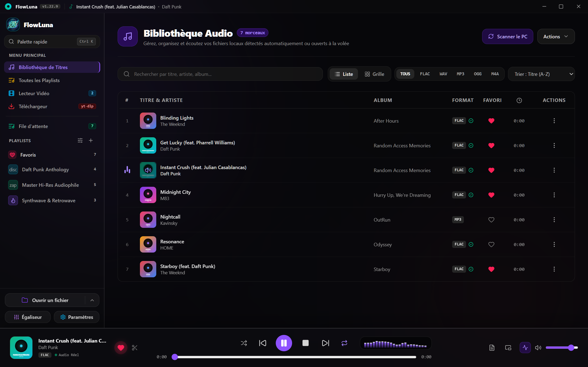
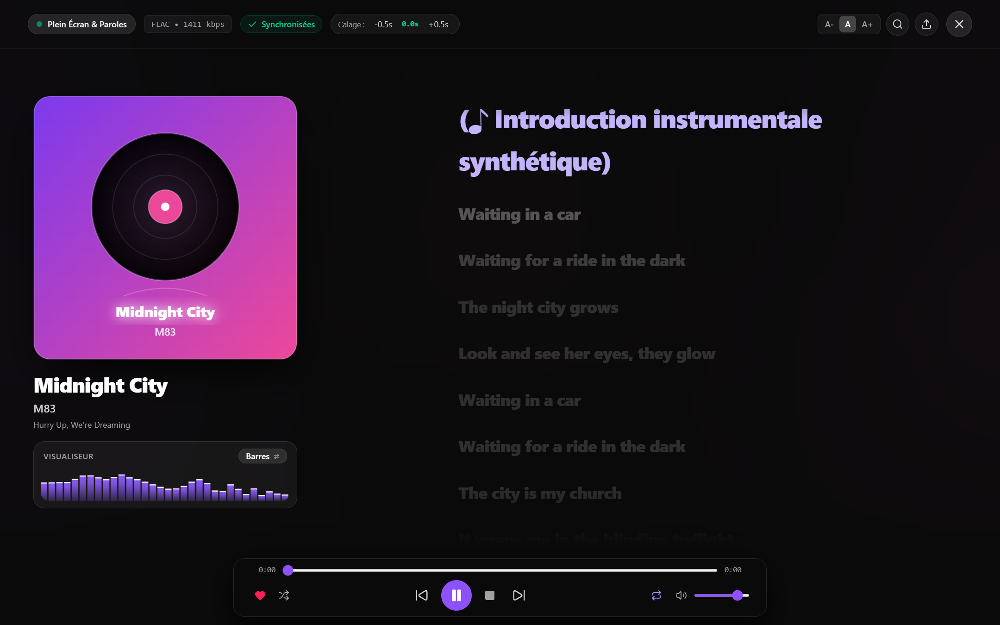
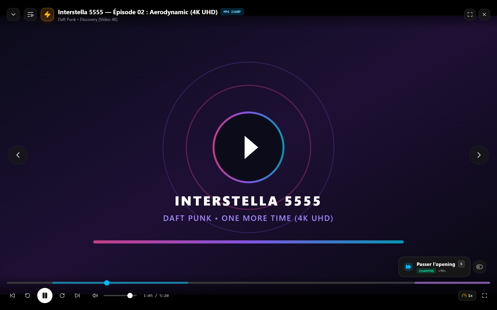
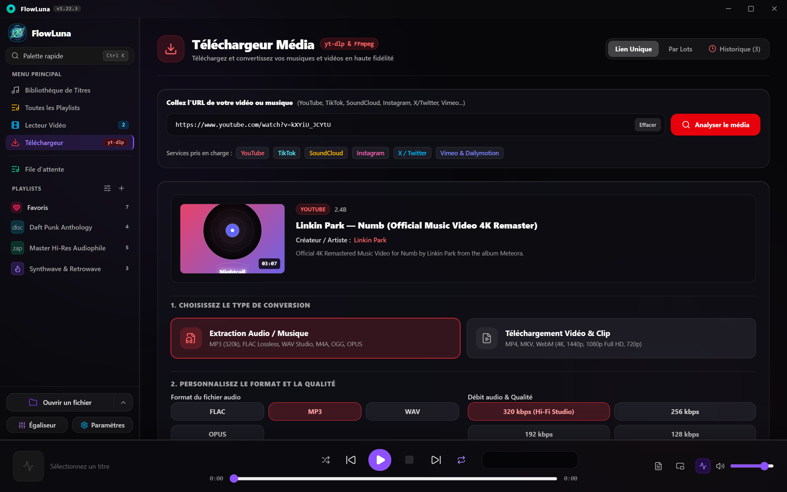
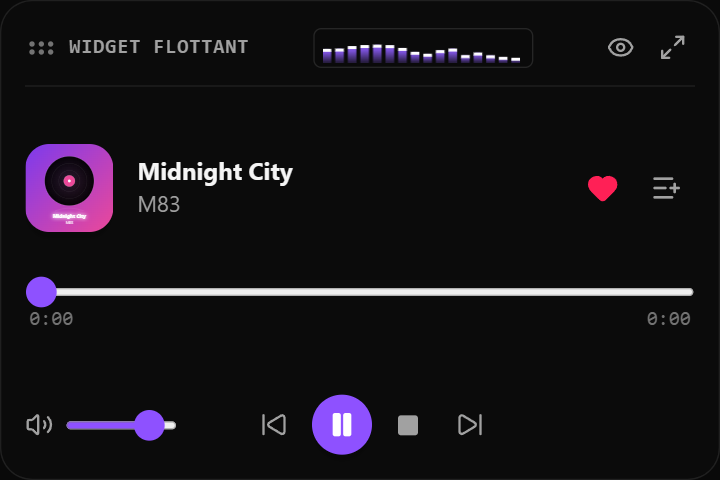

# 🎵 FlowLuna — Lecteur Multimédia Hi-Fi, Vidéo 4K & Downloader Natif Windows

<div align="center">
  

  <p>
    <a href="https://github.com/vortexazur/FlowLuna/releases"></a>
    <a href="https://github.com/vortexazur/FlowLuna"></a>
    <a href="https://dotnet.microsoft.com/"></a>
    <a href="https://developer.microsoft.com/microsoft-edge/webview2/"></a>
    <a href="https://github.com/videolan/libvlcsharp"></a>
    <a href="LICENSE"></a>
    <a href="https://github.com/vortexazur/FlowLuna/actions"></a>
    <a href="https://github.com/vortexazur/FlowLuna"></a>
  </p>

  <p>
    <strong>Lecteur multimédia tout-en-un audiophile et cinéma pour Windows avec interface Pure Glass XAML, accélération matérielle Direct3D 11, synchronisation labiale A/V parfaite (0 ms), détection intelligente Skip Opening/Ending, mode Marathon, intégration IA agnostique (Cloud & Local Ollama / LM Studio), égaliseur 10 bandes, visualiseur réactif et téléchargeur universel haute performance yt-dlp & FFmpeg.</strong>
  </p>

  <p>
    <em>🤖 Logiciel conçu et développé avec l'Intelligence Artificielle (IA)</em>
  </p>

  <p>
    <a href="https://github.com/vortexazur/FlowLuna/releases">Télécharger la Dernière Version</a> • 
    <a href="#-fonctionnalités-clés">Fonctionnalités Clés</a> • 
    <a href="#-installation">Installation</a> • 
    <a href="#-raccourcis-clavier">Raccourcis Clavier</a> • 
    <a href="#-architecture-technique">Architecture</a> • 
    <a href="#-sécurité--confidentialité">Sécurité</a>
  </p>
</div>

---

## ✨ Présentation

> [!NOTE]
> **Projet conçu & développé par Intelligence Artificielle (IA) :**  
> FlowLuna est une application développée de bout en bout avec l'assistance de l'Intelligence Artificielle (IA). L'architecture logicielle, le code source (C# .NET 9, React 19, TypeScript), les intégrations multimédias et le design de l'interface utilisateur ont été entièrement programmés et itérés en pair-programming assisté par IA.

**FlowLuna** est une application de bureau conçue pour offrir une expérience multimédia sans compromis sous Windows. Propulsée par **C# .NET 9**, **Microsoft Edge WebView2**, **LibVLCSharp (VideoLAN)**, **React 19**, **Vite** et un serveur in-process ultra-rapide **ASP.NET Core Kestrel**, elle réunit le meilleur du traitement audio numérique haute fidélité, de la lecture vidéo cinéma 4K accélérée par le matériel avec zéro latence audio/vidéo, d'un système intelligent d'intro-skipping, de modèles d'IA agnostiques (Cloud et locaux hors-ligne) et d'un outil d'extraction multimédia haute performance avec une empreinte système optimisée.

---

## 🚀 Fonctionnalités Clés

### 🎬 Moteur Multimédia LibVLCSharp (VideoLAN) & Interface Pure Glass
FlowLuna réunit la puissance du moteur multimédia **LibVLCSharp** ([VideoLAN](https://github.com/videolan/libvlcsharp)) et une interface fluide **Pure Glass & Acrylic** accélérée par DWM :
- **Décodage universel matériel :** Prise en charge native de tous les codecs audio et conteneurs vidéo (*FLAC, ALAC, MP3, WAV, AAC, Opus, Ogg Vorbis, MKV, MP4, WebM, MOV, AVI*).
- **Égaliseur graphique LibVLC 10 bandes :** Calibré selon les fréquences ISO standard VLC (31 Hz à 16 kHz) avec pré-amplification et presets audiophiles officiels.
- **Translucidité Pure Glass personnalisable :** Effet de profondeur dépoli moderne avec gestion dynamique de l'opacité et accentuation des couleurs.

<p align="center">
  
</p>

### 🎤 Mode Plein Écran & Paroles Synchronisées (Karaoké)
- **Synchronisation dynamique en direct :** Défilement automatique fluide avec surlignage lumineux de la phrase en cours d'écoute.
- **Gestion des intros instrumentales & calage manuel :** Détection automatique des pauses instrumentales et micro-ajustement fin (`-0.5s` / `+0.5s`) sauvegardé par morceau.
- **Ambiance visuelle immersive :** Arrière-plan dynamique calculé selon les teintes de la pochette de l'album.

<p align="center">
  
</p>

### 📺 Lecteur Vidéo Haute Définition, Mode Cinéma (4K / 1080p) & Skip Opening Intelligent
- **Synchronisation Labiale A/V Parfaite (0 ms de Dérive) :** Architecture de rendu multi-processus levant les goulots d'étranglement CPU, avec pipeline de décodage matériel Direct3D 11 (`MediaFoundationD3D11VideoDecoder`) pour une synchronisation absolue entre la voix et les mouvements des lèvres sous Windows 10 & 11.
- **Détection & Saut Intelligent des Ouvertures (Skip Opening / Ending) :**
  - Moteur hybride en cascade multi-niveaux : intégration de l'API **Anime-Skip** (avec support de clé personnalisée), chapitres intégrés (*MKV / MP4*), sous-titres, corrélation acoustique, détection des silences et analyse IA.
  - Bouton d'action flottant instantané **« Passer l'opening [S] »** avec badge de source et de fiabilité (*Chapitre, Anime-Skip, Acoustique, IA*).
  - Repères visuels dynamiques sur la barre de progression (opening en bleu ciel, ending en violet).
  - Commutateur **Auto-Skip** pour passer automatiquement les génériques sans la moindre manipulation.
- **Mode Marathon (Binge-Watching Séries & Animes) :**
  - Enchaînement automatique des épisodes avec préchargement dynamique en tâche de fond.
  - Overlay de compte à rebours interactif à la fin de chaque épisode avec bouton d'accès immédiat à l'épisode suivant.
  - Bouton d'activation rapide du Mode Marathon (`Zap`) directement accessible dans la barre supérieure du lecteur.
- **File d'Attente Vidéo (Screenbox & Playlists Dédiées) :**
  - Tiroir flottant de file d'attente vidéo accessible en un clic (`ListVideo`).
  - Ajout direct de fichiers par lot, réorganisation et sauvegarde immédiate en playlist.
- **Contrôles de Précision & Ratios :**
  - Chevrons latéraux de saut temporel (+10s / -10s) et badge d'amplitude flottant.
  - Ratios d'affichage dynamiques (*Contain, Cover, 16:9, 4:3, 21:9*).
  - Vitesse de lecture fine réglable (0.5x, 0.75x, 1x, 1.25x, 1.5x, 2x) et badge de résolution dynamique (ex: *MP4 2160p*).
- **Double Mode Picture-in-Picture (PiP) :** Mini-lecteur vidéo docké dans l'interface et mode Picture-in-Picture natif OS Always-on-Top pour continuer à regarder vos vidéos par-dessus vos autres applications.

<p align="center">
  
</p>

### 🧠 Gestionnaire Agnostique des Modèles d'IA (Cloud & Inférence Locale Ollama / LM Studio)
FlowLuna est **100% agnostique vis-à-vis des modèles d'intelligence artificielle** :
- **Fournisseurs Cloud Universels :** Prise en charge native sans dépendance lourde d'OpenAI (GPT-4o, o3-mini), Anthropic Claude (Claude 3.5 Sonnet / Opus), Mistral AI (Mistral Large), Google Gemini (Gemini 2.0 Flash / Pro) et de tout proxy ou serveur compatible OpenAI.
- **Inférence Locale 100% Privée & Hors-Ligne :** Exécutez vos propres modèles open-source (Llama 3, Mistral, Qwen, DeepSeek) sur votre propre matériel via **Ollama** (`http://localhost:11434`) ou **LM Studio** (`http://localhost:1234`), sans abonnement et sans connexion Internet.
- **Découverte Automatique & Test de Latence :** Détection automatique des modèles locaux installés et banc d'essai interactif avec mesure du ping en direct.
- **Assistance IA Transversale :**
  - Enrichissement automatique des métadonnées (titre, artiste principal, featuring, album, année, genre) dans l'éditeur de tags audio (`TrackTagEditorModal`).
  - Détection contextuelle de haut niveau des ouvertures et génériques vidéo.

### 🔀 Lecture Aléatoire Impartiale (Algorithme de Fisher-Yates)
- **Permutation Équitable (Knuth Shuffle) :** Chaque piste de votre bibliothèque ou playlist est lue **exactement une seule fois** avant toute répétition.
- **Exclusion du Titre en Cours :** Le morceau actuellement joué est sanctuarisé en tête de file sans risque d'être rejoué dans le même cycle.
- **Navigation Historique Cohérente :** Les boutons Suivant et Précédent respectent fidèlement la file mélangée.
- **Protection Anti-Doublon :** En mode « Répéter tout », le premier titre du cycle suivant ne peut jamais être identique au dernier titre du cycle achevé.

### 📊 Visualiseur Audio Temps Réel Intégré à la Barre de Lecture
- **Intégration Pure Glass dans la Barre Inférieure :** Visualiseur FFT dynamique incrusté directement dans la barre de contrôle, sans empiéter sur l'espace d'écoute.
- **5 Styles Graphiques au Clic :** *LEDs Micro* (par défaut), *Barres Spectre*, *Oscilloscope*, *Piliers Stéréo* et *Radar Circulaire*.
- **Gestion Éco-Énergie Intelligente :** Mise en veille instantanée du rendu canvas en pause et suspension automatique lors de la lecture vidéo pour dédier 100% des ressources graphiques au flux vidéo.

### ⚡ Downloader Universel Haute Performance (yt-dlp & FFmpeg)
- **Binaires natifs Windows 64-bit :** `yt-dlp.exe` et `ffmpeg.exe` intégrés hors ASAR pour un accès direct et des vitesses d'exécution optimales.
- **Suivi temps réel & Historique :** Progression en direct avec jauge, vitesse en Mo/s, panneau d'historique dédié et intégration directe dans la bibliothèque.
- **Formats audio sans perte & vidéo HD :** Téléchargement en *FLAC, MP3 (320 kbps HD), WAV, AAC, Opus* ou vidéos jusqu'en *4K UHD / 1080p*.
- **Compatibilité multi-plateformes :** Extraction depuis YouTube, SoundCloud, TikTok, Instagram, X/Twitter, etc.

<p align="center">
  
</p>

### 🖼️ Mode Widget Flottant Exclusif Always-on-Top
- **Transformation exclusive :** D'un simple clic sur le widget flottant, l'application complète s'efface pour ne laisser **QUE** le widget flottant ultra-compact sur votre bureau.
- **Mode Always-on-Top natif :** Fenêtre Windows compacte (360x240) épinglée au premier plan au-dessus de vos jeux et applications, avec barre de déplacement, spectre temps réel et menu de sélection de playlists dynamique.

<p align="center">
  
</p>

### 🎛️ Traitements DSP & Normalisation Sonore EBU R128
- Égaliseur paramétrique 10 bandes avec contrôle indépendant du gain (±12 dB).
- Presets audiophiles prédéfinis : *Flat, Bass Boost, Treble Boost, Électronique, Rock, Acoustique, Vocal, etc.*
- Traitements sonores intégrés : Amplification des basses (*Bass Boost*), clarté des aigus (*Treble Boost*), pré-amplification (*Preamp Gain*) et **normalisation sonore intelligente EBU R128 / ReplayGain** (-14 LUFS Streaming, -18 LUFS ReplayGain, -23 LUFS Broadcast / Cinéma) sur une ligne pleine largeur dédiée avec limiteur True Peak à -1.0 dBTP.

### 🪟 Intégration Native Windows XAML, SMTC & Discord RPC
- **Hôte XAML WPF / Windows App SDK :** Fenêtre native optimisée pour le Microsoft Store avec effet de fond DWM Mica / Acrylic et consommation de RAM allégée via Workstation GC.
- **Windows SMTC (System Media Transport Controls) :** Vignette multimédia officielle Windows 11/10 avec pochette d'album haute résolution, titre, artiste et commandes lors du réglage de volume ou sur l'écran de verrouillage.
- **Discord Rich Presence (RPC) :** Affiche automatiquement votre musique en temps réel sur votre profil Discord via Named Pipes locaux.
- **Raccourcis Clavier Multimédias Globaux :** Pilotez la lecture avec les touches matérielles de votre clavier ou casque (`Play/Pause`, `Suivant`, `Précédent`, `Stop`) via le hook Win32 `WM_APPCOMMAND`.
- **Barre de titre Frameless Glass :** Design translucide avec zones de glissement fluide et commandes de fenêtre intégrées (*Réduire, Agrandir/Restaurer, Fermer*).

### 💾 Bibliothèque Locale & Outils de Production
- Analyse et importation ultra-rapides de dossiers musicaux locaux avec scanner en tâche de fond.
- Outil de découpe de morceaux (*Audio Trimmer*) et de fusion de pistes (*Audio Merger*).
- Éditeur de métadonnées et tags de pistes avec assistance IA (*Track Tag Editor*).
- Détecteur de doublons et recherche instantanée avec palette de commandes (`Ctrl + K`).

---

## 💻 Matrice des Prérequis

| Composant | Prérequis Minimal | Recommandé |
|---|---|---|
| **Système d'exploitation** | Windows 10 (64-bit, Version 1903+) | Windows 11 (64-bit, Version 22H2+) |
| **Processeur (CPU)** | Intel Core i3 / AMD Ryzen 3 ou équivalent | Intel Core i5 / AMD Ryzen 5 ou supérieur |
| **Mémoire Vive (RAM)** | 4 Go | 8 Go ou plus |
| **Espace Disque** | 400 Mo disponibles | 1 Go+ (selon le cache hors-ligne) |
| **Accélération Graphique** | Compatible DirectX 11 / OpenGL | GPU dédié ou iGPU récent |

---

## 📦 Installation

1. Rendez-vous dans la section [Releases](https://github.com/vortexazur/FlowLuna/releases).
2. Téléchargez l'installateur officiel **`FlowLuna-Setup-1.23.9.exe`** (~115 Mo).
3. Lancez l'exécutable : l'application installe automatiquement le binaire natif C# .NET 9 + WebView2, configure les dépendances audio LibVLCSharp et crée les raccourcis sur le Bureau et le Menu Démarrer.

---

## ⌨️ Raccourcis Clavier

| Raccourci | Action |
|---|---|
| <kbd>Espace</kbd> ou Touche Multimédia Play/Pause | Lecture / Pause |
| <kbd>N</kbd> ou Touche Multimédia Suivant | Titre suivant |
| <kbd>P</kbd> ou Touche Multimédia Précédent | Titre précédent |
| <kbd>←</kbd> / <kbd>→</kbd> | Reculer / Avancer de 5 secondes |
| <kbd>↑</kbd> / <kbd>↓</kbd> | Augmenter / Diminuer le volume |
| <kbd>M</kbd> | Activer / Désactiver le mode Muet |
| <kbd>L</kbd> | Ajouter ou retirer le titre des Favoris |
| <kbd>S</kbd> | Basculer la lecture aléatoire (*Shuffle* en musique) / **Passer l'opening** (en vidéo) |
| <kbd>R</kbd> | Basculer le mode répétition (*Off / Tout / Piste*) |
| <kbd>E</kbd> | Ouvrir l'Égaliseur 10 bandes |
| <kbd>F</kbd> ou <kbd>Double-clic</kbd> | Mode Plein Écran (Paroles synchronisées / Cinéma vidéo) |
| <kbd>W</kbd> | Mode Mini-Lecteur d'appoint compact Always-on-Top |
| <kbd>Ctrl</kbd> + <kbd>K</kbd> | Ouvrir la Palette de commandes rapide |

---

## 🛠️ Développement & Compilation Locale

### 1. Cloner le dépôt et installer les dépendances
```bash
git clone https://github.com/vortexazur/FlowLuna.git
cd FlowLuna
npm install
```

### 2. Lancer la version Native C# .NET 9 + WebView2
```bash
# Compile le frontend React et lance le conteneur natif .NET 9
npm run dotnet:run
```

### 3. Compiler l'exécutable unique C# .NET 9 pour production
```bash
# Génère un binaire autonome auto-extractible optimisé dans release-dotnet/FlowLuna.exe
npm run dotnet:publish
```

---

## 🏗️ Architecture Technique

```
flowluna/
├── FlowLuna.Windows/             # Hôte natif C# .NET 9 & WebView2 (Prêt Microsoft Store)
│   ├── Program.cs                # Point d'entrée STA, boucle d'événements & initialisation
│   ├── MainWindow.cs             # Fenêtre WPF frameless, DWM Acrylic backdrop Win32 & Tray
│   └── Services/
│       ├── HttpServer.cs         # Serveur Kestrel in-process local (endpoints REST & audio)
│       ├── DownloaderEngine.cs   # Moteur yt-dlp C# avec parsing regex & flux SSE
│       └── LibraryScanner.cs     # Indexation multithreadée ultra-rapide des disques
├── bin/                          # Binaires Windows externes exclus
│   ├── yt-dlp.exe                # Moteur d'extraction et métadonnées
│   ├── ffmpeg.exe                # Moteur de transcodage et normalisation audio
│   └── ffprobe.exe               # Analyseur de flux multimédia
├── src/                          # Application Frontend React 19 + Tailwind CSS
│   ├── components/               # Composants d'interface (Pure Glass, Visualiseur, Library...)
│   ├── services/                 # Moteurs audio Web Audio API, filtres biquad
│   ├── i18n.ts                   # Internationalisation 9 langues (FR, EN, ES, DE, IT, PT, JA, ZH, RU)
│   └── types.ts                  # Modèles de données & constantes
├── release-dotnet/               # Sortie du binaire unique autonome C# (FlowLuna.exe)
└── vite.config.ts                # Configuration Vite avec base relative './'
```

---

## 🔒 Sécurité & Confidentialité

FlowLuna est conçu avec une attention intransigeante portée à la sécurité de l'utilisateur, à l'intégrité de ses données locales et au respect absolu de sa vie privée :

- **Zero-Telemetry & 100% Hors-Ligne :** Aucune collecte de données personnelles, aucune télémétrie ni traceur espion tiers. Votre bibliothèque, vos playlists et votre historique d'écoute demeurent confinés à 100% sur votre disque dur.
- **Inférence IA Agnostique & Privée :** Prise en charge native d'une exécution 100% locale via **Ollama** ou **LM Studio** sans abonnement ni transmission de vos métadonnées à des serveurs tiers distants.
- **Isolation IPC & Sandboxing WebView2 / Electron :** `contextIsolation` activé, `nodeIntegration` désactivé sur le moteur de rendu, exposition minimale et typée des API hôtes via `contextBridge` sans surface de passage direct vers le shell de l'OS.
- **Serveurs In-Process Sécurisés (ASP.NET Core Kestrel & Express) :**
  - Écoute strictement bornée à l'interface de bouclage locale (`127.0.0.1` / Loopback), rendant l'API invisible et inaccessible depuis le réseau local (LAN).
  - Contrôle d'accès CORS restreint aux origines applicatives locales autorisées (`localhost`, `127.0.0.1`, protocoles natifs).
  - Validation anti-traversée de répertoire (*Path Traversal Protection*) stricte sur les routes de streaming local (`/api/library/stream`), d'artworks (`/api/covers/:name`) et filtrage strict sur une liste blanche d'extensions multimédias autorisées.
- **Exécution Sûre des Binaires Externes (`yt-dlp` & `ffmpeg`) :** Appel direct par vecteurs d'arguments isolés (`ProcessStartInfo.ArgumentList` en C# et `execFile` en Node.js) prévenant toute injection de commande shell.
- **Protection du Système d'Exploitation :** Garde-fous interdisant toute interaction ou altération de fichiers en dehors du répertoire applicatif et des dossiers multimédias de l'utilisateur.

---

## 📄 Licence

Ce projet est sous licence **GNU General Public License v3.0 (GPLv3)**. Consultez le fichier [LICENSE](LICENSE) pour plus de détails.

